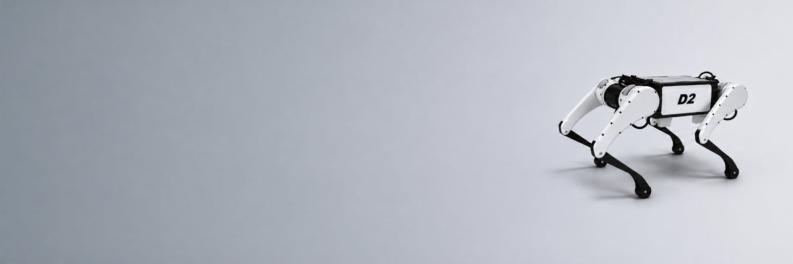

**NavBot** develops robotics hardware for educators, developers, and research teams. Explore quadruped robots, wheel-legged robots, and STEM robotics kits to find a platform for your next project.

<Frame>
  
</Frame>

## Explore our robots

<CardGroup cols={3}>
  <Card
    title="Quadruped robots"
    icon="robot"
    href="https://navbot.com/products/kinatric-d2"
  >
    Explore the Kinatric D2 legged robotics platform.
  </Card>
  <Card
    title="Wheel-legged robots"
    icon="gears"
    href="https://navbot.com/products/kinatric-d2w"
  >
    Discover the Kinatric D2W, which combines articulated legs and driven wheels.
  </Card>
  <Card
    title="STEM robotics kits"
    icon="graduation-cap"
    href="https://navbot.com/collections/complete-robots"
  >
    Find educational kits and desktop robots for hands-on learning.
  </Card>
</CardGroup>

## Start your project

<CardGroup cols={2}>
  <Card title="Get started" icon="rocket" href="/quickstart">
    Choose your platform, review its configuration, and find the right resources.
  </Card>
  <Card title="Contact support" icon="envelope" href="mailto:sales@navbot.com">
    Ask about products, project requirements, or technical support.
  </Card>
</CardGroup>

## About NavBot

Founded in 2023 and based in Frisco, Texas, NavBot helps you learn, prototype, and build with robotics. Learn more [about NavBot](https://navbot.com/pages/about) or browse the [official website](https://navbot.com/).

For product questions or support, email [sales@navbot.com](mailto:sales@navbot.com).
